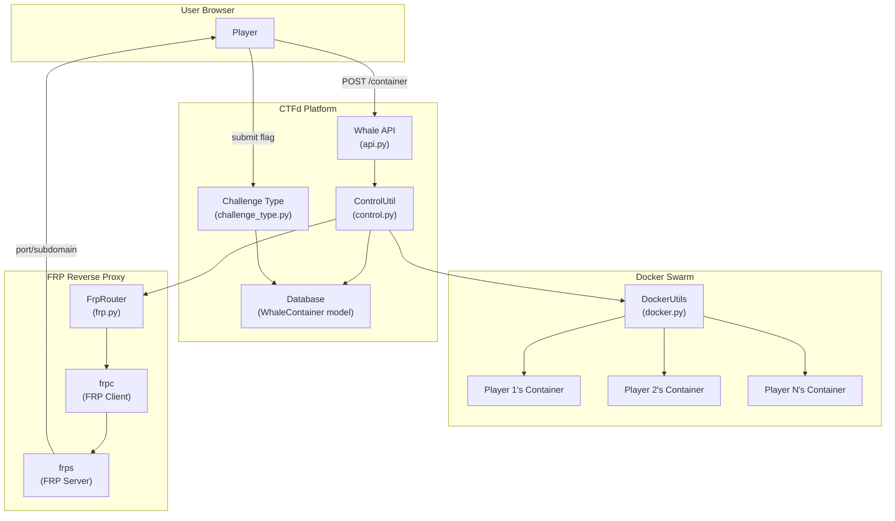
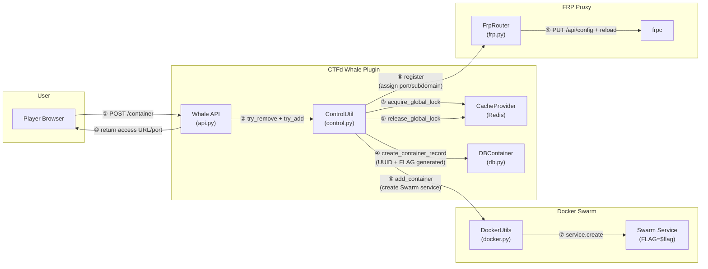
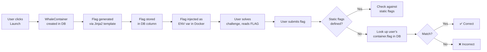
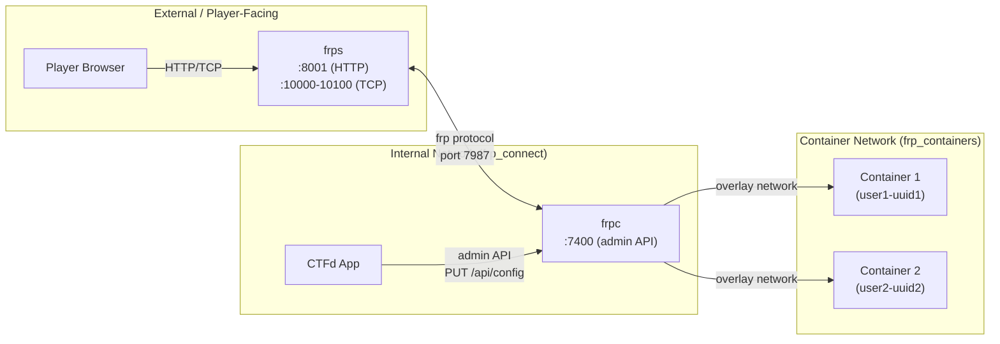
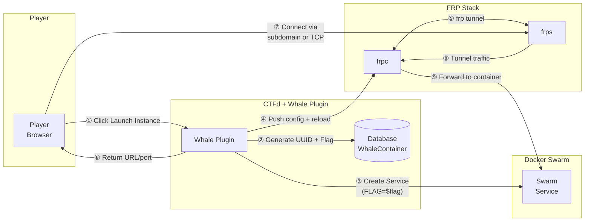
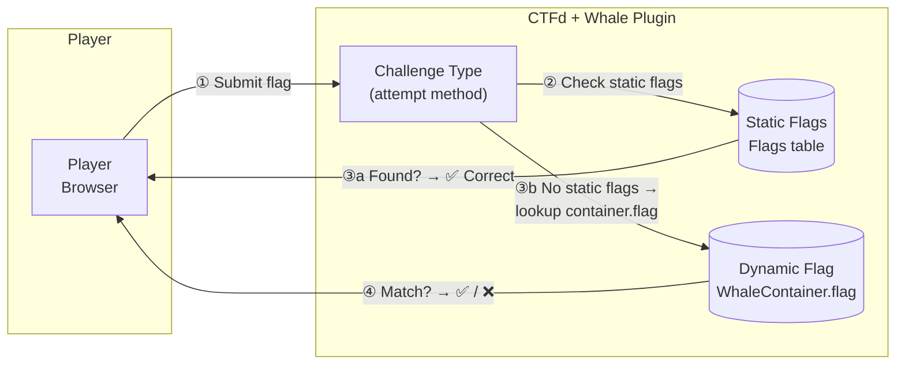
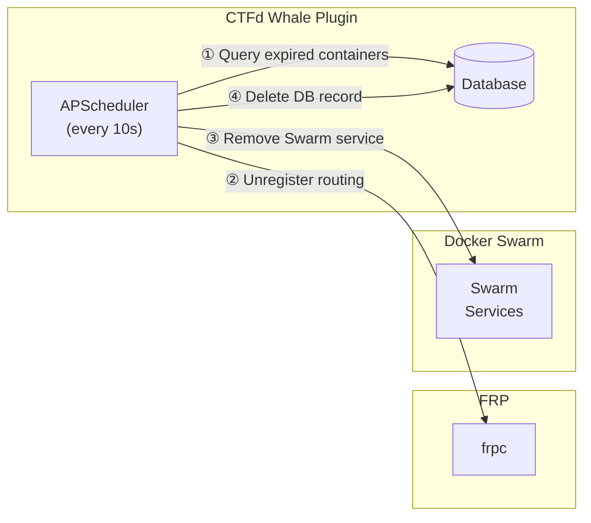

# CTFd-Whale Architecture Walkthrough

CTFd-Whale is a CTFd plugin that gives each player their **own isolated Docker container** for a challenge, with a **unique flag per instance**. It solves the problem of shared challenge infrastructure where players can interfere with each other or share static flags.

## High-Level Architecture



---

## 1. Container Management

### 1.1 The Container Lifecycle

Each user can only have **one container at a time** across all challenges. The lifecycle is:

```
Create → Running → (Renew?) → Expire/Destroy
```

### 1.2 Container Creation Flow

When a player clicks "Launch Instance", the following happens:



| Step | Component | Action |
|------|-----------|--------|
| ① | Player → API | `POST /plugins/ctfd-whale/container?challenge_id=X` |
| ② | API → ControlUtil | Remove any existing container, then call `try_add_container` |
| ③ | ControlUtil → Cache | Acquire global Redis lock (prevents race conditions) |
| ④ | ControlUtil → DB | Create `WhaleContainer` row — UUID and FLAG generated here |
| ⑤ | ControlUtil → Cache | Release global lock |
| ⑥ | ControlUtil → DockerUtils | Create Docker Swarm service with `FLAG` env var |
| ⑦ | DockerUtils → Swarm | `services.create()` on the overlay network |
| ⑧ | ControlUtil → FrpRouter | Register routing (pop port from Redis or set subdomain) |
| ⑨ | FrpRouter → frpc | Push full config via admin API, trigger reload |
| ⑩ | API → Player | Return access URL or `nc` command |

**Key code path:** [api.py:L91-L106](file:///home/dan/Desktop/ctfd-whale1/CTFd/CTFd/plugins/ctfd-whale/api.py#L91-L106) → [control.py:L13-L38](file:///home/dan/Desktop/ctfd-whale1/CTFd/CTFd/plugins/ctfd-whale/utils/control.py#L13-L38)

### 1.3 Two Types of Container Deployments

The plugin supports two modes, determined by the `docker_image` field on the challenge:

#### Standalone Container (single image string)

When `docker_image` is a plain string like `my-vuln-app:latest`:

- Creates **one Docker Swarm service** named `{user_id}-{uuid}`
- Connects it to the `frp-containers` overlay network
- The flag is passed as an `ENV` variable: `FLAG=flag{...}`

```python
# docker.py:L67-L82
DockerUtils.client.services.create(
    image=container.challenge.docker_image,
    name=f'{container.user_id}-{container.uuid}',
    env={'FLAG': container.flag},
    networks=[get_config("whale:docker_auto_connect_network", "ctfd_frp-containers")],
    resources=docker.types.Resources(
        mem_limit=..., cpu_limit=...
    ),
    labels={'whale_id': f'{container.user_id}-{container.uuid}'},
    constraints=['node.labels.name==' + node],
    endpoint_spec=docker.types.EndpointSpec(mode='dnsrr', ports={})
)
```

#### Grouped Containers (JSON object)

When `docker_image` is a JSON object like `{"web": "nginx:latest", "db": "mysql:5.7"}`:

- Creates a **dedicated overlay network** with a unique subnet carved from `whale:docker_subnet`
- Deploys **multiple services** on that private network, each accessible by alias name
- The first service in the JSON is treated as the "main" one (gets the container's UUID as name)
- All services share the same `FLAG` env var

```python
# docker.py:L84-L160 — network creation + multi-service deployment
network = DockerUtils.client.networks.create(
    network_name, internal=True,
    ipam=ipam_config, attachable=True,
    driver="overlay", scope="swarm"
)
```

### 1.4 Container Removal

Removal ([control.py:L41-L55](file:///home/dan/Desktop/ctfd-whale1/CTFd/CTFd/plugins/ctfd-whale/utils/control.py#L41-L55)) is the reverse:

1. **Unregister** from FRP router (free up port, reload frpc config)
2. **Remove Docker services** by matching the label `whale_id={user_id}-{uuid}`
3. **Remove Docker network** (if grouped containers)
4. **Delete DB record**

### 1.5 Auto-Expiration

A background job runs **every 10 seconds** ([__init__.py:L117-L120](file:///home/dan/Desktop/ctfd-whale1/CTFd/CTFd/plugins/ctfd-whale/__init__.py#L117-L120)):

```python
scheduler.add_job(
    id='whale-auto-clean', func=auto_clean_container,
    trigger="interval", seconds=10
)
```

It queries for containers whose `start_time` is older than `whale:docker_timeout` (default 3600s = 1 hour) and destroys them.

### 1.6 Container Renewal

Users can extend their container's lifetime ([control.py:L57-L74](file:///home/dan/Desktop/ctfd-whale1/CTFd/CTFd/plugins/ctfd-whale/utils/control.py#L57-L74)):
- Adds `docker_timeout` seconds to `start_time`
- Capped at `docker_max_renew_count` renewals (default 5)
- No Docker operations needed — just a DB timestamp update

### 1.7 Resource Limits

Each challenge defines:
- `memory_limit` — e.g. `"128m"`, `"1g"` (converted via [DockerUtils.convert_readable_text](file:///home/dan/Desktop/ctfd-whale1/CTFd/CTFd/plugins/ctfd-whale/utils/docker.py#L182-L195))
- `cpu_limit` — e.g. `0.5` (converted to nanocpus: `0.5 * 1e9`)

### 1.8 One Container Per User Constraint

The system enforces **one container per user** at all times:
- Before creating a new container, the API always calls `try_remove_container(user_id)` first ([api.py:L97](file:///home/dan/Desktop/ctfd-whale1/CTFd/CTFd/plugins/ctfd-whale/api.py#L97))
- If a user tries to view a container for a different challenge than the one running, they get a 403 with a link to the active challenge

---

## 2. Flag Management

### 2.1 Flag Generation

Flags are generated **at container record creation time** — before the Docker container even starts. This happens in the [WhaleContainer.__init__](file:///home/dan/Desktop/ctfd-whale1/CTFd/CTFd/plugins/ctfd-whale/models.py#L81-L89) constructor:

```python
def __init__(self, user_id, challenge_id):
    self.user_id = user_id
    self.challenge_id = challenge_id
    self.start_time = datetime.now()
    self.renew_count = 0
    self.uuid = str(uuid.uuid4())
    self.flag = Template(get_config(
        'whale:template_chall_flag', '{{ "flag{"+uuid.uuid4()|string+"}" }}'
    )).render(container=self, uuid=uuid, random=random, get_config=get_config)
```

Key points:
- The flag is generated using a **Jinja2 template** stored in `whale:template_chall_flag`
- Default template: `{{ "flag{"+uuid.uuid4()|string+"}" }}` → produces something like `flag{a1b2c3d4-e5f6-...}`
- The template has access to: `container` (the WhaleContainer instance), `uuid`, `random`, and `get_config`
- This means admins can customize the flag format (e.g., `CTF{...}`, include user_id, etc.)

### 2.2 Flag Injection into Container

The flag is passed to the Docker container as an **environment variable** named `FLAG`:

```python
# docker.py:L70
env={'FLAG': container.flag}
```

The challenge's Docker image is expected to read `$FLAG` and use it appropriately (e.g., write it to a file, embed it in a web response, etc.).

### 2.3 Flag Validation (The `attempt` Method)

Flag checking happens in [challenge_type.py:L69-L93](file:///home/dan/Desktop/ctfd-whale1/CTFd/CTFd/plugins/ctfd-whale/challenge_type.py#L69-L93) and follows a **two-tier approach**:

```python
@classmethod
def attempt(cls, challenge, request):
    submission = data["submission"].strip()
    flags = Flags.query.filter_by(challenge_id=challenge.id).all()

    if len(flags) > 0:
        # TIER 1: Check static flags first (admin-defined)
        for flag in flags:
            if get_flag_class(flag.type).compare(flag, submission):
                return True, "Correct"
        return False, "Incorrect"
    else:
        # TIER 2: Check the per-user dynamic flag from the container
        user_id = current_user.get_current_user().id
        q = db.session.query(WhaleContainer)
        q = q.filter(WhaleContainer.user_id == user_id)
        q = q.filter(WhaleContainer.challenge_id == challenge.id)
        records = q.all()
        if len(records) == 0:
            return False, "Please solve it during the container is running"
        container = records[0]
        if container.flag == submission:
            return True, "Correct"
        return False, "Incorrect"
```

````carousel
### Tier 1: Static Flags (Admin-Defined)
If the admin has manually added flags to the challenge via the CTFd admin panel, those are checked **first** using the standard CTFd flag comparison (supports static and regex flags).

This means you can have a dynamic_docker challenge with a **static flag** — the Docker container is just for the environment, not for flag generation.
<!-- slide -->
### Tier 2: Dynamic Per-User Flags
If **no static flags** are defined, the system looks up the user's running container for that challenge and compares the submission directly against `container.flag`.

> [!IMPORTANT]
> The container **must be running** for the flag to validate. If the container has expired, the DB record is deleted, and the flag becomes unverifiable — the user gets: *"Please solve it during the container is running"*.
````

### 2.4 Flag Lifecycle Summary



---

## 3. Network Routing (FRP)

### 3.1 Why FRP?

Challenge containers run on an **internal Docker overlay network** — they are not directly reachable from the internet. FRP (Fast Reverse Proxy) creates tunnels from a publicly-accessible server to the internal containers.

### 3.2 Infrastructure Layout



### 3.3 Two Redirect Types

Each challenge has a `redirect_type` that determines how players access it:

| Type | Protocol | Player Accesses Via | FRP Config |
|------|----------|-------------------|------------|
| `http` | HTTP | `http://{uuid}.127.0.0.1.nip.io:8001/` | `type = http` with `subdomain` |
| `direct` | TCP/UDP | `nc 127.0.0.1 {port}` (port from 10000-10100 range) | `type = tcp` with `remote_port` |

### 3.4 How Routing Registration Works

When a container is registered ([frp.py:L96-L108](file:///home/dan/Desktop/ctfd-whale1/CTFd/CTFd/plugins/ctfd-whale/utils/routers/frp.py#L96-L108)):

1. **For `direct` type**: A port is popped from the available port set in Redis/cache
2. **For `http` type**: The subdomain is derived from the container's UUID
3. **`reload()` is called** which:
   - Collects ALL alive containers' routing rules
   - Builds a complete frpc configuration string
   - PUTs it to `frpc`'s admin API (`/api/config`)
   - Triggers a reload via `GET /api/reload`

> [!WARNING]
> The `reload()` method ([frp.py:L44-L84](file:///home/dan/Desktop/ctfd-whale1/CTFd/CTFd/plugins/ctfd-whale/utils/routers/frp.py#L44-L84)) rebuilds the **entire** frpc config every time — it's not incremental. This is simple but could be a bottleneck at scale.

### 3.5 Port Management

For `direct` type challenges, ports are managed via Redis sets ([cache.py](file:///home/dan/Desktop/ctfd-whale1/CTFd/CTFd/plugins/ctfd-whale/utils/cache.py)):
- On init: all ports in range `[frp_direct_port_minimum, frp_direct_port_maximum]` minus already-used ports are added to a Redis set
- On container create: `spop` a port from the set
- On container destroy: `sadd` the port back to the set

### 3.6 The Docker Network Topology

```
┌─────────────────────────────────────────────────┐
│ Docker Compose Networks                         │
│                                                 │
│  "default"     — nginx, ctfd, frps              │
│  "internal"    — db, cache, ctfd (no external)  │
│  "frp_connect" — ctfd, frps, frpc (internal)    │
│  "frp_containers" — frpc + challenge containers │
│                   (overlay, attachable)          │
└─────────────────────────────────────────────────┘
```

- `frpc` sits on **both** `frp_connect` (to talk to `frps`) and `frp_containers` (to reach challenge containers)
- Challenge containers are created on `frp_containers`, which is an **overlay network** so it works across Swarm nodes
- `frpc` can resolve container services by name (e.g., `42-a1b2c3d4-...`) because they share the overlay network

---

## 4. Concurrency & Safety

| Mechanism | Purpose | Implementation |
|-----------|---------|----------------|
| **Global container lock** | Prevents race conditions during container creation | Redis distributed lock ([cache.py:L161-L166](file:///home/dan/Desktop/ctfd-whale1/CTFd/CTFd/plugins/ctfd-whale/utils/cache.py#L161-L166)) |
| **Per-user lock** | Prevents rapid-fire requests from same user | Redis lock per user_id ([cache.py:L141-L148](file:///home/dan/Desktop/ctfd-whale1/CTFd/CTFd/plugins/ctfd-whale/utils/cache.py#L141-L148)) |
| **Frequency limiter** | 60-second cooldown between container operations | Session-based check ([decorators.py:L32-L53](file:///home/dan/Desktop/ctfd-whale1/CTFd/CTFd/plugins/ctfd-whale/decorators.py#L32-L53)) |
| **Max container count** | Prevents resource exhaustion | `whale:docker_max_container_count` check before creation |
| **File lock** | Prevents duplicate scheduler instances (multiple workers) | `fcntl.lockf` on `/tmp/ctfd_whale.lock` ([__init__.py:L110-L112](file:///home/dan/Desktop/ctfd-whale1/CTFd/CTFd/plugins/ctfd-whale/__init__.py#L110-L112)) |

---

## 5. Summary: End-to-End Flow

### 5.1 Container Launch & Access



| Step | Description |
|------|-------------|
| ① | Player clicks "Launch Instance" → `POST /plugins/ctfd-whale/container` |
| ② | Whale generates UUID + unique flag (Jinja2), stores in `WhaleContainer` table |
| ③ | Creates Docker Swarm service with `FLAG` injected as environment variable |
| ④ | Pushes routing config to frpc admin API and triggers reload |
| ⑤ | frpc establishes tunnel to frps over internal `frp_connect` network |
| ⑥ | Returns access URL (HTTP subdomain) or `nc` command (TCP port) to player |
| ⑦ | Player connects to challenge via frps public endpoint |
| ⑧ | frps forwards traffic through frp tunnel to frpc |
| ⑨ | frpc routes to the container on the `frp_containers` overlay network |

### 5.2 Flag Submission & Validation



### 5.3 Auto-Cleanup (Every 10s)


