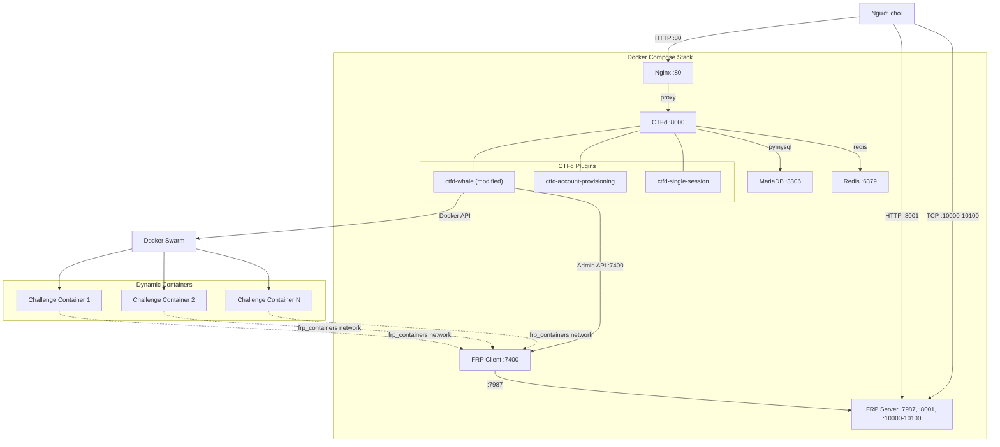
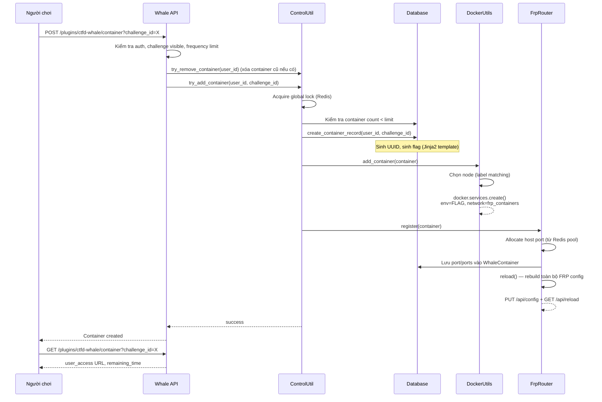
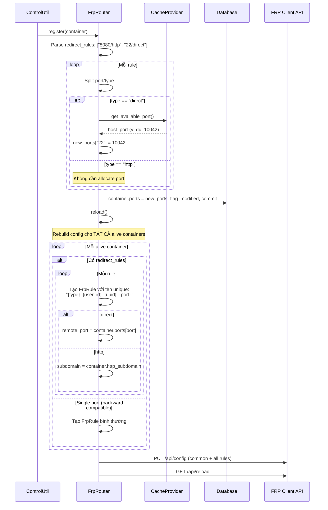
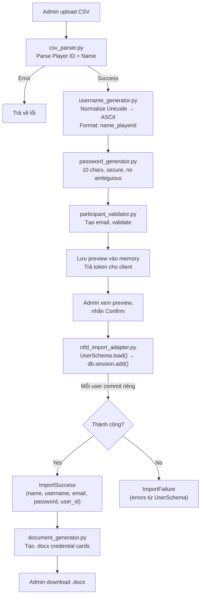
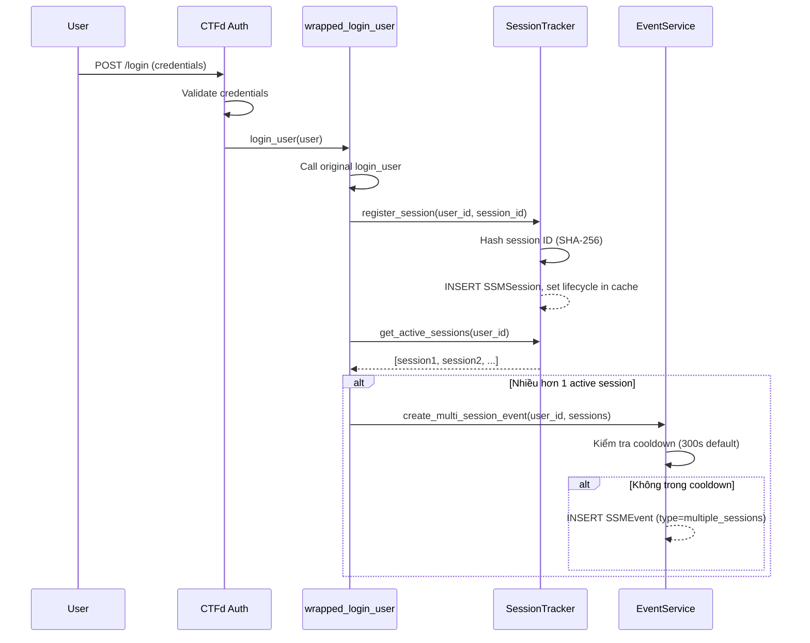
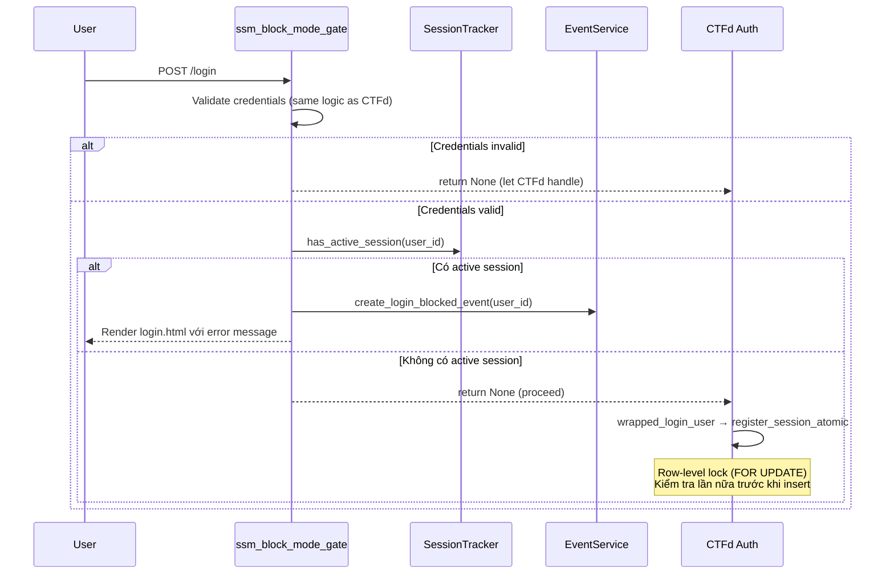
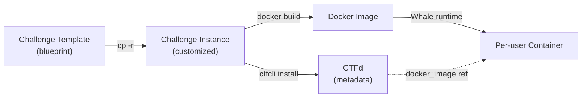

# Kiến trúc kỹ thuật

Tài liệu này mô tả kiến trúc kỹ thuật của hệ thống ctfd-ops. Mục tiêu giúp developer hiểu cách hệ thống hoạt động và có thể maintain/phát triển tiếp.

---

## 1. Kiến trúc tổng quan



### Các component

| Component | Vai trò |
|---|---|
| **Nginx** | Reverse proxy cho CTFd, lắng nghe port 80 |
| **CTFd** | Core platform — quản lý user, challenge, scoring, plugin system |
| **MariaDB** | Lưu trữ dữ liệu CTFd, Whale containers, SSM sessions/events |
| **Redis** | Session cache, Whale port/network pool, SSM heartbeat throttle |
| **FRP Server (frps)** | Nhận traffic từ người chơi, forward tới challenge containers qua frpc |
| **FRP Client (frpc)** | Nhận config từ Whale, tạo tunnel tới challenge containers |
| **Docker Swarm** | Orchestrate challenge containers dưới dạng services |
| **Challenge Containers** | Môi trường cô lập per-user chứa ứng dụng có lỗ hổng |

### Networks

| Network | Driver | Mục đích |
|---|---|---|
| `default` | bridge | Giao tiếp chung (nginx, ctfd, frps) |
| `internal` | bridge (internal) | CTFd ↔ DB, CTFd ↔ Redis (không expose ra ngoài) |
| `frp_connect` | bridge (internal) | CTFd ↔ frpc, frpc ↔ frps |
| `frp_containers` | overlay (attachable) | frpc ↔ challenge containers (subnet `172.2.0.0/16`) |

---

## 2. CTFd Core

CTFd là framework nền tảng, cung cấp:
- Quản lý user, team, challenge, flag, scoring
- Plugin system: plugins đặt trong `CTFd/CTFd/plugins/`, mỗi plugin có `load(app)` entry point
- REST API (`CTFd_API_v1`)
- Web UI (Jinja2 templates)

Dockerfile sử dụng multi-stage build. Stage build cài dependencies (bao gồm `requirements.txt` của từng plugin). Stage release chạy Gunicorn với user `ctfd` (UID 1001).

Entry point (`docker-entrypoint.sh`): chạy `flask db upgrade` (migration) rồi khởi động Gunicorn.

---

## 3. CTFd-Whale Plugin

### 3.1. Cấu trúc module

```
ctfd-whale/
├── __init__.py          # Plugin load, blueprint, APScheduler
├── models.py            # WhaleConfig, WhaleRedirectTemplate, DynamicDockerChallenge, WhaleContainer
├── api.py               # REST API endpoints (user + admin)
├── challenge_type.py    # DynamicValueDockerChallenge class, flag validation
├── decorators.py        # challenge_visible, frequency_limited
└── utils/
    ├── docker.py        # Docker Swarm service creation/removal
    ├── control.py       # ControlUtil: add/remove/renew container
    ├── db.py            # DBContainer, DBRedirectTemplate queries
    ├── cache.py         # CacheProvider (Redis + Filesystem fallback)
    ├── setup.py         # Default configs, redirect templates
    ├── checks.py        # Health checks
    └── routers/
        ├── __init__.py  # Router factory (singleton)
        ├── base.py      # BaseRouter interface
        ├── frp.py       # FrpRouter implementation
        └── trp.py       # TrpRouter (alternative TLS router)
```

### 3.2. Model layer

**`DynamicDockerChallenge`** — kế thừa `DynamicChallenge` (dynamic scoring):
- `docker_image`: tên Docker image (string hoặc JSON cho grouped containers)
- `redirect_type`: loại redirect (`http` hoặc `direct`) — dùng cho single-port
- `redirect_port`: port bên trong container — dùng cho single-port
- `redirect_rules`: chuỗi multi-port rules (ví dụ: `"8080/http,22/direct"`) — **modification của project**
- `memory_limit`, `cpu_limit`: resource limits

**`WhaleContainer`** — lưu trạng thái container đang chạy:
- `user_id`, `challenge_id`: gắn container với user và challenge
- `uuid`: identifier duy nhất
- `flag`: per-user flag (sinh khi tạo container)
- `port`: allocated host port (single-port)
- `ports`: JSON mapping `{container_port: host_port}` (multi-port) — **modification của project**
- `start_time`, `renew_count`, `status`

**`WhaleRedirectTemplate`** — template Jinja2 cho FRP config và access URL:
- `key`: loại redirect (`http`, `direct`)
- `frp_template`: template FRP config
- `access_template`: template hiển thị cho user

### 3.3. Challenge type

Class `DynamicValueDockerChallenge` (file `challenge_type.py`) đăng ký challenge type `dynamic_docker` với CTFd.

Method `attempt()` xử lý flag validation:
1. Kiểm tra static flags trong CTFd trước (nếu có)
2. Nếu không có static flag, tìm `WhaleContainer` của user cho challenge hiện tại
3. So sánh submission với `container.flag`
4. Kiểm tra `challenge_id` khớp (**security fix của project**)

---

## 4. FRP Network Layer

FRP (Fast Reverse Proxy) tạo tunnel từ bên ngoài tới challenge containers trong Docker overlay network.

```mermaid
graph LR
    USER["Người chơi"] -->|":8001 (HTTP)" hoặc ":10000-10100 (TCP)"| FRPS["FRP Server"]
    FRPS -->|tunnel :7987| FRPC["FRP Client"]
    FRPC -->|overlay network| CC["Challenge Container<br/>user_id-uuid"]
```

### Redirect types

- **`http`**: FRP tạo HTTP vhost. Người chơi truy cập qua `http://<uuid>.<domain_suffix>:<http_port>/`
- **`direct`**: FRP tạo TCP tunnel. Người chơi truy cập qua `nc <ip> <allocated_port>`

### Cách Whale quản lý FRP

Whale không ghi file config — thay vào đó sử dụng FRP Client Admin API:
1. `GET /api/config` — lấy config hiện tại (lần đầu)
2. `PUT /api/config` — ghi toàn bộ config mới (common + tất cả rules)
3. `GET /api/reload` — reload frpc

Mỗi lần register/unregister container, Whale **rebuild toàn bộ config** từ database (method `FrpRouter.reload()`).

---

## 5. Workflow: Challenge Container Creation



### Chi tiết từng bước

1. **User request**: POST tới `/api/v1/plugins/ctfd-whale/container`
2. **Decorators**: `@authed_only`, `@challenge_visible`, `@frequency_limited` (cooldown 5 giây, Redis lock)
3. **Remove old**: Xóa container cũ của user (mỗi user chỉ có 1 container)
4. **Global lock**: Redis lock tránh race condition khi tạo container đồng thời
5. **DB record**: Tạo `WhaleContainer` — UUID và flag được sinh tại đây
6. **Docker**: Tạo Swarm service với env `FLAG=<generated_flag>`, attach vào network `frp_containers`
7. **Router register**: Allocate port, lưu DB, rebuild FRP config
8. **Cleanup on error**: Nếu bất kỳ bước nào fail, Docker service bị remove, DB record bị xóa

### Container destruction

Container bị destroy khi:
- User nhấn "Stop Instance" (DELETE API)
- Container hết timeout (APScheduler kiểm tra mỗi 10 giây)
- Admin xóa thủ công

Flow: `Router.unregister()` (release port, reload FRP) → `DockerUtils.remove_container()` (remove Swarm service) → `DBContainer.remove_container_record()`

---

## 6. Multi-Port Support (Modification của project)

### 6.1. Tổng quan

Đây là modification chính của project đối với CTFd-Whale upstream. Cho phép một challenge expose nhiều port với các redirect type khác nhau.

### 6.2. Cấu hình

Trong `challenge.yml` hoặc CTFd admin, thay vì `redirect_type` + `redirect_port`, sử dụng `redirect_rules`:

```
redirect_rules: "8080/http,22/direct"
```

### 6.3. Flow chi tiết



### 6.4. Access URL rendering

Khi user GET container info, `FrpRouter.access()` render access strings:
- `direct` rule: `nc <frp_direct_ip> <allocated_port>`
- `http` rule: `<a href="http://<subdomain>.<domain>:<port>/">Link to the Challenge (<container_port>)</a>`

Nhiều access strings được nối bằng `<br>` và hiển thị trên giao diện challenge.

### 6.5. Cleanup

`FrpRouter.unregister()` release tất cả port trong `container.ports` về Redis pool, rồi reload FRP config (exclude container đang xóa).

### 6.6. Backward compatibility

Toàn bộ logic kiểm tra `container.challenge.redirect_rules` trước. Nếu field này trống/null, flow cũ qua `redirect_type` + `redirect_port` + `container.port` (single port) được sử dụng. Không ảnh hưởng challenge đã tồn tại.

---

## 7. Per-User Flag

> Đây là tính năng có sẵn của CTFd-Whale upstream.

### Tạo flag

Flag được sinh trong `WhaleContainer.__init__()` (file `models.py`):

```python
self.flag = Template(get_config(
    'whale:template_chall_flag', '{{ "flag{"+uuid.uuid4()|string+"}" }}'
)).render(container=self, uuid=uuid, random=random, get_config=get_config)
```

Template mặc định: `flag{<random-uuid>}`. Admin có thể tùy chỉnh template trong Whale settings.

### Truyền vào container

Flag được truyền qua biến môi trường `FLAG` khi tạo Docker Swarm service (file `docker.py`):

```python
env={'FLAG': container.flag}
```

Challenge application đọc `os.environ['FLAG']` và sử dụng (ví dụ: lưu vào database, render trên page).

### Validation

File `challenge_type.py`, method `attempt()`:
1. Nếu challenge có static flags (Flags table) → kiểm tra static flags trước
2. Nếu không có static flag → tìm WhaleContainer của user cho challenge_id hiện tại
3. So sánh submission với `container.flag` (exact match)

---

## 8. Account Provisioning Plugin

### 8.1. Kiến trúc

```
ctfd-account-provisioning/
├── __init__.py                    # Plugin load
├── config.py                      # Default configs
├── routes.py                      # Blueprint: upload, provision, download
├── models.py                      # ProvisioningJob model (encrypted DB storage)
├── services/
│   ├── csv_parser.py              # Parse CSV (Player ID + Name)
│   ├── username_generator.py      # Unicode → ASCII username
│   ├── password_generator.py      # Secure password generation
│   ├── participant_validator.py   # Validation + email generation
│   ├── ctfd_import_adapter.py     # CTFd UserSchema import
│   ├── document_generator.py     # Word .docx generation
│   ├── provisioning_service.py   # Orchestrator
│   └── storage.py                # Encrypted DB persistence (ProvisioningJob)
├── i18n/                          # EN + VI translations
├── templates/                     # Admin UI
└── assets/                        # CSS/JS
```

### 8.2. Workflow



### 8.3. Chi tiết implementation

**CSV Parser** (`csv_parser.py`): Yêu cầu 2 cột header: "Player ID" và "Name" (case-insensitive). Sử dụng `csv.reader` với encoding `utf-8-sig`.

**Username Generator** (`username_generator.py`):
1. Thay `đ/Đ` → `d/D` (Vietnamese special)
2. NFKD normalization → remove combining marks
3. Lowercase, replace spaces/hyphens → underscore
4. Remove non-alphanumeric
5. Kết hợp: `{normalized_name}_{safe_player_id}`
6. Kiểm tra trùng với existing DB usernames

**Password Generator** (`password_generator.py`): `secrets` module, loại bỏ ký tự dễ nhầm (0, O, 1, l, I), đảm bảo có uppercase + lowercase + digit.

**Import Adapter** (`ctfd_import_adapter.py`): Sử dụng `UserSchema().load()` — cùng logic với CTFd CSV import. Mỗi user được commit riêng — lỗi 1 user không rollback các user khác. Set `verified=True`, `hidden=False`.

**Document Generator** (`document_generator.py`): Tạo file Word (.docx) bằng `python-docx`. Mỗi account là 1 table card với header, name, username, password, note.

**Storage**: Preview data và document output lưu trong database (bảng `account_provisioning_jobs`) dưới dạng encrypted blob (Fernet). Encryption key được tự động sinh và lưu tại `UPLOAD_FOLDER/.account-provisioning.key`, hoặc có thể set qua config `ACCOUNT_PROVISIONING_KEY`. Data có TTL (preview: 1 giờ, document: 24 giờ mặc định) và tự động cleanup khi hết hạn. Data persist qua CTFd restart.

---

## 9. Single Session Monitor Plugin

### 9.1. Kiến trúc

```
ctfd-single-session/
├── __init__.py              # Plugin load
├── config.py                # Constants, defaults
├── models.py                # SSMSession, SSMEvent
├── session_tracker.py       # Session lifecycle
├── hooks.py                 # Monkey-patch login/logout, before_request
├── event_service.py         # Security events with cooldown
├── routes.py                # Admin blueprint (HTML + JSON API)
├── templates/               # Admin UI (sessions, events, settings)
└── assets/                  # CSS/JS
```

### 9.2. Database models

**`SSMSession`** (`ssm_sessions`):
- `user_id`, `session_hash` (SHA-256 của session ID), `cache_key`
- `created_at`, `last_seen_at`, `is_active`
- Index: `(user_id, is_active)` cho query nhanh

**`SSMEvent`** (`ssm_events`):
- `user_id`, `username`, `event_type` (`multiple_sessions` hoặc `login_blocked`)
- `session_count`, `sessions_info` (JSON)
- `resolved`, `resolved_at`, `resolved_by`

### 9.3. Monitoring Mode flow



### 9.4. Block Mode flow



### 9.5. Session validation

`SessionTracker.is_session_valid()` kiểm tra 3 điều kiện:
1. **Lifetime**: `created_at + PERMANENT_SESSION_LIFETIME > now`
2. **App lifecycle**: cache key `ssm:lifecycle:{cache_key}` khớp với hash của `SECRET_KEY` hiện tại. Nếu CTFd restart với SECRET_KEY mới, session cũ bị invalidate.
3. **Cache existence**: `cache.get(cache_key)` — session phải tồn tại trong Redis/filesystem

### 9.6. Heartbeat

`ssm_session_heartbeat` (before_request): cập nhật `last_seen_at` với throttle qua Redis key `ssm:hb:{sid_hash}` (mặc định 30 giây).

### 9.7. Admin actions

- Force logout session: xóa cache key + mark `is_active=False`
- Force logout all sessions of user
- Resolve security event

---

## 10. Challenge Templates

### 10.1. Cấu trúc

Templates nằm trong `challenge-templates/`. Mỗi template là một thư mục chứa:

```
template-name/
├── challenge.yml    # Metadata cho ctfcli (type: dynamic_docker)
├── Dockerfile       # Build environment
├── src/             # Source code ứng dụng (chứa lỗ hổng)
├── README.md        # Hướng dẫn cho challenge author
└── solution/        # Writeup + solve script
```

### 10.2. Quan hệ giữa các component



### 10.3. Workflow

1. Challenge author copy template: `cp -r challenge-templates/sqli-flask-sqlite challenges/my-sqli`
2. Sửa `challenge.yml`: tên, mô tả, docker_image
3. Sửa source code trong `src/`: thay đổi logic lỗ hổng
4. Build image: `docker build -t my-sqli:latest .`
5. Deploy: `ctfcli challenge install challenges/my-sqli`
6. Whale sử dụng image name từ `challenge.yml` để tạo container khi user request

### 10.4. Flag injection

Template không hardcode flag. `entrypoint.sh` hoặc application code đọc `$FLAG` (biến môi trường do Whale inject) và sử dụng (ví dụ: insert vào database, render trên page ẩn).

---

## 11. Database Schema (Custom models)

### Whale models (bảng do Whale tạo)

| Bảng | Mô tả |
|---|---|
| `whale_config` | Key-value config (docker_api_url, frp settings, ...) |
| `whale_redirect_template` | FRP/access templates (http, direct) |
| `dynamic_docker_challenge` | Extends dynamic_challenge (docker_image, redirect_type, redirect_port, redirect_rules, ...) |
| `whale_container` | Active containers (user_id, challenge_id, uuid, flag, port, ports, start_time, ...) |

### SSM models (bảng do Single Session Monitor tạo)

| Bảng | Mô tả |
|---|---|
| `ssm_sessions` | Active sessions (user_id, session_hash, cache_key, is_active, last_seen_at) |
| `ssm_events` | Security events (event_type, session_count, resolved) |

### Account Provisioning models

| Bảng | Mô tả |
|---|---|
| `account_provisioning_jobs` | Encrypted provisioning job data (token_hash, owner_id, payload, expires_at) |

Plugin sử dụng CTFd `Users` model qua `UserSchema` để tạo user accounts, và lưu trạng thái preview/document tạm thời trong bảng riêng với encryption (Fernet) và TTL tự động.

---

## 12. Infrastructure

### Docker Compose services

```yaml
services:
  ctfd:        # Python/Flask app, mount Docker socket
  nginx:       # Reverse proxy (:80 → ctfd:8000)
  db:          # MariaDB 10.11
  cache:       # Redis 4
  frps:        # FRP server (expose :8001, :10000-10100)
  frpc:        # FRP client (admin API :7400)
  permissions: # Alpine init container (chown volumes, exits)
```

### Volume mounts

| Mount | Mục đích |
|---|---|
| `.data/CTFd/logs` | CTFd log files |
| `.data/CTFd/uploads` | CTFd uploaded files |
| `.data/mysql` | MariaDB data |
| `.data/redis` | Redis data |
| `/var/run/docker.sock` | Docker API socket (mounted vào CTFd container) |
| `./conf/frp` | FRP config files |
| `./conf/nginx` | Nginx config |
| `.:/opt/CTFd:ro` | CTFd source code (read-only) |

### Workers

`WORKERS=1` trong `docker-compose.yml`. Whale sử dụng file lock (`/tmp/ctfd_whale.lock`) để đảm bảo chỉ 1 worker chạy APScheduler (auto-clean expired containers mỗi 10 giây).
